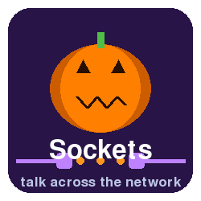

# CS101 Data Structures

Activity 07: Network Programming with Python Sockets

## Assigned and Due

- **Assigned**: Friday, 30 October 2026 at start of class
- **Due and Expiration**: Monday, 2 November 2026 at start of class

Note: the expiration date is the last date you can submit your work for a grade.

<center>



</center>

## Table of Contents
- [CS101 Data Structures](#cs101-data-structures)
  - [Assigned and Due](#assigned-and-due)
  - [Table of Contents](#table-of-contents)
  - [Overview](#overview)
  - [What Is a Socket?](#what-is-a-socket)
  - [Learning Objectives](#learning-objectives)
  - [Project Goals](#project-goals)
  - [Before You Start: Find a Partner](#before-you-start-find-a-partner)
  - [Instructions](#instructions)
  - [Deliverable](#deliverable)
  - [Submission](#submission)
  - [GatorGrade](#gatorgrade)
  - [Seeking Assistance](#seeking-assistance)

## Overview

In this activity you will complete three tutorials that teach you how computers talk to each other over a network using **sockets**. You will use the `uv` package manager to create **one** shared environment for the whole activity, and you will run every command from it.

The tutorials progress in difficulty:

1. Play a **ping game** that sends signals from one laptop to another and measures how fast they travel
2. Build a **direct-message chat system** where you send messages to a classmate by their IP address
3. Play **Haunted Forest**, a colourful Halloween game made with `pygame` and `socket`, where up to four players race through a dark forest to collect the most pumpkins while dodging ghosts and owls

All of the Python code is provided and explained. In each tutorial you only finish a few small TODOs, and several of them use the **file reading** skills from our last lessons together with **lists** and **dictionaries**.

## What Is a Socket?

A **socket** is one end of a conversation between two programs. If you think of the network as a phone system, then:

- an **IP address** is like a phone number: it identifies a computer,
- a **port** is like an extension number: it identifies one program on that computer,
- a **server** is the program that waits for calls,
- a **client** is the program that makes the call.

Once the call is connected, both programs can send and receive text (really, **bytes**) as often as they like. Almost everything you do online, from web pages to multiplayer games, is built on this idea.


## Learning Objectives

By completing this activity, you will be able to:

1. **Explain** what an IP address, a port, a client, and a server are
2. **Write** Python programs that open, send, receive, and close a TCP socket connection
3. **Encode and decode** messages between Python strings and bytes
4. **Combine sockets with file operations**, lists, and dictionaries to store and look up information
5. **Describe** how a client-server game keeps several players in the same world


## Project Goals

- Create one Python environment with `uv` and reuse it for every tutorial
- Install and use `pygame-ce` (the maintained version of `pygame`) for graphics
- Complete small TODOs in Python code that read files into lists and dictionaries
- Connect two or more computers (or two terminal windows on one computer) with sockets
- Play a multiplayer game that you can explain, line by line


## Before You Start: Find a Partner

Sockets are most fun with at least two people. Find a partner (or a group of up to four for Tutorial 3) and make sure all of your laptops are connected to the **same Wi-Fi network**.

Some campus Wi-Fi networks block laptops from talking to each other. If you cannot connect to your partner, you have two options:

- Use a phone hotspot that every group member joins, or
- Test alone by opening **two terminal windows** on one computer and using the special address `127.0.0.1`. This address always means "this computer".

You will still earn full credit by testing alone. If your computer shows a firewall pop-up asking about incoming connections for Python, choose **Allow**.


## Instructions

Complete the tutorials in order. Each tutorial includes background information, setup commands, code explanations, and expected output.

1. [Tutorial 1: The Ping Game](tutorials/tutorial_01/tutorial_01.md)
2. [Tutorial 2: Direct Messages with a Chat Server](tutorials/tutorial_02/tutorial_02.md)
3. [Tutorial 3: Haunted Forest, a Multiplayer Pumpkin Hunt](tutorials/tutorial_03/tutorial_03.md)

Create the shared environment **once**, in the top folder of this activity (the folder that contains this `README.md`):

```bash
uv init --bare # create only pyproject.toml file
uv add pygame-ce
```

Then, for each tutorial directory:

```bash
cd tutorials/tutorial_0X
uv run <program>
```

When you run `uv run` from inside a tutorial folder, `uv` searches the parent folders, finds the shared `pyproject.toml`, and uses its environment. Do **not** run `uv init` inside the tutorial folders.

These tutorials intentionally avoid `source .venv/bin/activate` because activation commands vary across operating systems and shells. Running tools with `uv run <program>` is consistent on macOS, Linux, and Windows.


## Deliverable

*Note: This is a check mark grade.*

After you finish the tutorials, complete the writing assessment in [writing/reflection.md](writing/reflection.md).

You are submitting:

- **Shared environment** (created in Tutorial 1):
  - `pyproject.toml`
  - `uv.lock`
- **Tutorial 01** (code and data files):
  - `tutorials/tutorial_01/src/show_my_ip.py`
  - `tutorials/tutorial_01/src/ping_server.py`
  - `tutorials/tutorial_01/src/ping_client.py`
  - `tutorials/tutorial_01/src/ping_stats.py`
  - `tutorials/tutorial_01/data/ping_log.txt` (created when you run `ping_client.py`)
- **Tutorial 02** (code files):
  - `tutorials/tutorial_02/src/chat_server.py`
  - `tutorials/tutorial_02/src/chat_client.py`
  - `tutorials/tutorial_02/data/contacts.txt`
- **Tutorial 03** (code files):
  - `tutorials/tutorial_03/src/game_settings.py`
  - `tutorials/tutorial_03/src/game_server.py`
  - `tutorials/tutorial_03/src/game_client.py`
- **Reflection**:
  - `writing/reflection.md`


## Submission

Please commit and push your work regularly. Example commands:

```bash
git add -A
git commit -m "Describe your changes"
git push
```

After pushing, verify that your files appear in your GitHub repository.


## GatorGrade

You can check baseline requirements with:

```bash
gatorgrade --config config/gatorgrade.yml
```

Some of the checks run your programs with `uv run`, so run `gatorgrade` from the top folder of the activity. The checks do **not** need a network or a window: they test the file-reading functions that you completed.


## Seeking Assistance

Students who have questions about this project outside of lab time are invited to ask in the course Discord channel or during office hours.
